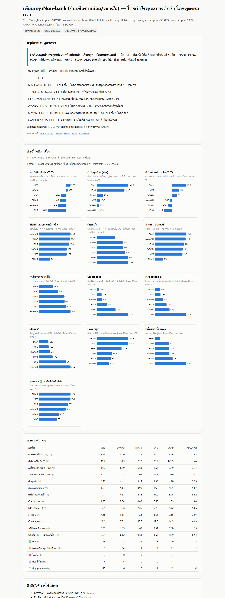

# earnings-check — เครื่องจับผิดคำพูดผู้บริหาร

> การบ้าน AI Investor Alpha · Day 1 → Day 2

| | |
|---|---|
| **ชื่อเล่น** | Volk |
| **กลุ่ม** | กลุ่ม 1 · อ่านงบ / Oppday / Earnings |
| **โจทย์ 1 บรรทัด** | skill `/earnings-check` สรุปงบ ดึงเทป Oppday อัตโนมัติ แล้วตรวจว่าผู้บริหารพูดตรงกับตัวเลขในงบไหม ใช้ได้ทุกหุ้น ทดลองกับกลุ่มจัดจำหน่ายไอที (SIS · SYNEX · ADVICE) และกลุ่ม Non-bank 6 ตัว (MTC · SAWAD · THANI · HENG · SCAP · AMANAH) |
| **ลิงก์ผลงาน** | [output/](output/) — รายงานรายบริษัท 10 ตัว + หน้าเทียบกลุ่ม 2 กลุ่ม |
| **สถานะ** | พร้อมตรวจ (2026-11-04) · ผู้ตรวจอ่านต่อไฟล์ไหน ดู [ท้ายไฟล์นี้](#ผู้ตรวจอ่านต่อที่ไหน) |

---

## สรุป 30 วินาที

- **ปัญหา:** นักลงทุนฟัง Oppday และอ่าน MD&A แล้วเชื่อเรื่องเล่าของผู้บริหาร แต่ไม่มีเวลาเปิดงบเทียบทีละตัวเลข
- **สิ่งที่สร้าง:** พิมพ์คำสั่งเดียว `/earnings-check <หุ้น>` ได้รายงานว่าผู้บริหารพูดตรงกับงบแค่ไหน · อะไรที่แย่ลงแต่ไม่ได้พูด · และตรวจตัวผู้บริหาร
- **ผล:** 10 บริษัท 471 คำพูด — **ผู้บริหารไทยแทบไม่พูดตัวเลขผิด แต่ "เลือกพูด" เกือบทุกบริษัท**
- **เชื่อได้เพราะ:** ทุกตัวเลขในรายงานสาวกลับถึงไฟล์ · ชีต · เซลล์ ของงบได้ 100% และมี AI อีกตัวเปิดต้นฉบับตรวจซ้ำทุกข้อที่สงสัย

## 1. ปัญหา

- ผู้บริหารพูดตัวเลขผิดได้ (ตั้งใจหรือไม่ก็ตาม)
- ที่พบบ่อยกว่าคือ **เลือกพูด** — พูดตัวเลขที่ดูดี และไม่พูดตัวเลขที่แย่ลง
- ตรวจด้วยมือ 1 หุ้น ต้องเปิดเทป 40 นาที + MD&A + งบ + หมายเหตุ ไล่เทียบหลายชั่วโมง

## 2. สิ่งที่เราสร้าง

**พิมพ์คำสั่งเดียว `/earnings-check MTC SAWAD THANI` ได้รายงานว่าผู้บริหารแต่ละบริษัทพูดตรงแค่ไหน**

```text
งบ + MD&A + เทป Oppday  ──►  ดึงคำพูดผู้บริหาร  ──►  เทียบกับงบ  ──►  ด่านตรวจเปิดต้นฉบับ  ──►  รายงาน
 (ดึงอัตโนมัติ)            (ทุกคำพูดมีนาทีในเทป)   (ทุกตัวเลขชี้ถึงเซลล์)   (ตรวจซ้ำทุกข้อที่สงสัย)    + หน้าเทียบกลุ่ม
```

ทุกคำพูดได้ผล 1 ใน 5 แบบ: ✅ ตรง · 🟡 ตรงแต่เลือกพูด · ❌ ไม่ตรง · ⬜ ตรวจไม่ได้ · 🔭 สัญญาอนาคต (เก็บไว้ตรวจงวดหน้า)
และมีรายการ **"สิ่งที่ผู้บริหารไม่ได้พูด"** — ตัวเลขที่แย่ลงชัดในงบ แต่ไม่มีใครเอ่ยถึง

ก่อนลงมือ เรา **เรียนจากคลิปและตารางของผู้สอนก่อน** ว่าแต่ละกลุ่มธุรกิจต้องดูอะไร แล้วเขียนเป็นคู่มือรายกลุ่มให้ระบบใช้ (Non-bank · จัดจำหน่ายไอที · ตรวจผู้บริหาร) รายละเอียดใน [PROCESS.md](PROCESS.md)

## 3. ผลที่ได้ (ไตรมาส 2/2569)

| กลุ่ม | สิ่งที่ระบบจับได้ |
|---|---|
| จัดจำหน่ายไอที (SIS · SYNEX · ADVICE) | กำไรโตทั้ง 3 ตัว แต่มีแค่ SYNEX ที่กำไรกลายเป็นเงินสด · SIS พูดว่ากำไรขั้นต้น "เพิ่มขึ้น" ทั้งที่ลดลง |
| สินเชื่อรายย่อย (MTC · SAWAD · THANI · HENG · SCAP · AMANAH) | ทุกตัว "เลือกพูด" เรื่องคุณภาพหนี้ · 3 ตัวกำไรโตเพราะลดสำรอง · 3 ตัวทำหนี้เสียให้ลดด้วยการตัดหนี้สูญ · SCAP บอกว่ายอดหนี้เสีย "ไม่เพิ่ม" แต่งบเพิ่ม 8.1% |



**ผลรายบริษัท (หลังด่านตรวจ)** — พูดตรง = ✅ ÷ (✅ + 🟡 + ❌)

| หุ้น | ✅ ตรง | 🟡 เลือกพูด | ❌ ไม่ตรง | พูดตรง | ข้อที่ควรรู้ |
|---|---|---|---|---|---|
| MTC | 33 | 1 | 0 | 97% | พอร์ตโตจริง แต่ NPL ขึ้น 2 ไตรมาสจนเกินเป้าตัวเอง และไม่พูดถึงขาดทุนจากการตัดรายการ 217 ล้านบาท |
| THANI | 37 | 1 | 0 | 97% | พูดตรงเกือบทั้งหมด แต่กำไรโตเพราะสำรองลด 70% ขณะที่กำไรก่อนสำรองลด |
| SIS | 39 | 0 | 2 | 95% | เปิดเผยเรื่องไม่ดีครบ แต่ CEO บอกว่ากำไรขั้นต้น "เพิ่มขึ้น" ทั้งที่ลดลง · เงินสดจากการดำเนินงาน 6 เดือนติดลบ |
| HENG | 35 | 4 | 0 | 90% | "คุณภาพหนี้ดีขึ้น" ทั้งที่ NPL ลดเพราะตัดหนี้ 243 ล้านบาท |
| AMANAH | 14 | 2 | 1 | 82% | ไม่มี Oppday · NPF ใน MD&A ต่ำกว่าวิธีของบริษัทเอง · เงินกู้ 100% ระยะสั้นจากผู้ถือหุ้นใหญ่ |
| SYNEX | 29 | 7 | 0 | 81% | ตัวเลขถูกแต่เลือกพูดด้านดี · ครึ่งปีหลังต้องโตราว 22% ถึงจะถึงเป้า |
| ADVICE | 21 | 6 | 0 | 78% | กำไรโต 82.5% แต่ไม่พูดถึงเงินสดที่ได้แค่ 0.28 เท่าของกำไร |
| SAWAD | 24 | 14 | 0 | 63% | "Coverage 2.21%" เป็นคนละตัว (ต่อ NPL จริง 57%) · NPL ขึ้น 5 ไตรมาสติด |
| SCAP | 19 | 11 | 4 | 56% | บอกว่ายอด NPL ไม่เพิ่ม แต่หมายเหตุงบ +8.1% · MD&A เขียนป้ายตัวเลขผิดงวด |
| CPALL (ชุดทดสอบ) | 38 | 0 | 0 | 100% | ตัวดึงตัวเลขตรงกับตารางที่ทำด้วยมือ 50/50 บรรทัด |

ตัวเลขทุกตัวมีที่มาในรายงานแต่ละบริษัทใน [output/](output/)

## 4. ตรวจตัวผู้บริหาร

นอกจากคำพูด ระบบยังเก็บหลักฐานเรื่องตัวคน จากเอกสารทางการเท่านั้น:

- **ใครถือหุ้นใหญ่ · ผู้ก่อตั้งยังถือไหม** (แบบ 56-1)
- **ผู้บริหารซื้อหรือขายหุ้นตัวเอง** (แบบ 59 ของ ก.ล.ต. ดึงอัตโนมัติ) เทียบวันกับ Oppday และวันประกาศงบ
- **เป้าที่เคยให้ไว้ทำได้จริงไหม** (เป้าใน 56-1 ปีก่อน เทียบผลจริง)
- **รายการเกี่ยวโยง** (เงินกู้จากผู้ถือหุ้นใหญ่ · ค่าบริหารให้บริษัทแม่)

| ตัวอย่างที่เจอ | |
|---|---|
| HENG | กรรมการในตระกูลผู้ก่อตั้งขายหุ้น 6 วันหลัง Oppday ที่ประกาศเป้ากำไร |
| THANI | กรรมการผู้จัดการซื้อหุ้นต่อเนื่อง |
| ADVICE | เป้าปี 2568 ทำไม่ถึง (เปิด iStore ได้ 17 จากเป้า 33 สาขา) · กรรมการผู้ก่อตั้งร่วมขาย 27.75 ล้านหุ้นช่วงต้นเม.ย. 2569 |
| AMANAH | เงินกู้ทั้งหมดเป็นเงินกู้ระยะสั้นจากผู้ถือหุ้นใหญ่ |

การซื้อขายหุ้นของผู้บริหารเขียนเป็น **ข้อมูลประกอบ ไม่ใช่ตัวชี้ขาด** — คลิปผู้สอนยกทั้งกรณีขายแล้วหุ้นขึ้นต่อและขายแล้วหุ้นลง · คะแนนพูดตรงวัด "ความตรงของคำพูดต่องบ" ไม่ใช่การวัดความซื่อสัตย์ทั้งตัวคน

## 5. ทำไมเชื่อผลได้

1. **ตัวเลขเข้ารายงานได้ทางเดียว** — ผ่านไฟล์ FACTS ที่ระบุ ไฟล์ · ชีต · เซลล์ ของงบ · มีสคริปต์ตรวจว่าทุกตัวเลขในรายงานสาวกลับไปถึงงบได้ 100%
2. **ด่านตรวจแยกจากคนดึงข้อมูล** — AI ตัวที่ดึงคำพูด (รุ่นเร็ว) กับ AI ตัวที่ตรวจ (รุ่นแรงสุด) เป็นคนละตัว ตัวตรวจเปิดต้นฉบับทุกข้อที่เป็น ❌ 🟡 และสุ่ม ✅
3. **ยุติธรรมกับผู้บริหาร** — ก่อนตัดสินว่าพูดผิด ต้องหาวิธีคิดของบริษัทเองก่อน (หลายข้อที่ดูเหมือนผิด กลายเป็นถูกเมื่อใช้สูตรของบริษัท)
4. **ระบบจับความผิดของตัวเองได้** — ด่านตรวจเจอบั๊กในสคริปต์ (นับเงินให้กู้เป็นเงินกู้) เราแก้ แล้วรันซ้ำทั้ง 10 บริษัทเทียบทีละบรรทัด

## 6. ใช้ทำอะไรต่อ

- **ก่อนเชื่อเรื่องเล่า**: เปิดรายงานดู 3 บรรทัดบนสุด รู้ทันทีว่าบริษัทนี้ผู้บริหารพูดตรงแค่ไหน และอะไรที่ไม่ได้พูด
- **ทุกไตรมาส**: งบไตรมาส 3 ออกกลาง พ.ย. 2569 รันคำสั่งเดิม ระบบตรวจ "สัญญาอนาคต" ที่เก็บไว้ให้เอง
- **หุ้นตัวไหนก็ได้**: ทดสอบกับหุ้นที่ไม่เคยเห็น (MOSHI) ทำงานได้เลย · เพิ่มกลุ่มใหม่ = เขียนคู่มือกลุ่ม 1 ไฟล์

**ไม่ใช่คำแนะนำซื้อขาย** — รายงานจบด้วย "ต้องเชื่ออะไร" และ "เงื่อนไขเปลี่ยนใจ" ไม่มีราคาเป้า

---

## ใช้งาน skill

```text
/earnings-check SIS SYNEX ADVICE     # หลายตัว = ได้รายงานรายตัว + หน้าเทียบกลุ่ม
/earnings-check CPALL                # ตัวเดียว
```

ต้องมี: Claude Code · Python 3.9+ · PyMuPDF · yt-dlp (ดึงคำบรรยาย Oppday) · ปลั๊กอิน stock-deepdive-lite (ใช้สคริปต์ดึงงบจาก ก.ล.ต. iDisc)
ไฟล์ของ skill อยู่ที่ [.claude/skills/earnings-check/](.claude/skills/earnings-check/) และทีม agent ที่ [.claude/agents/](.claude/agents/) · วิธีใช้ทีละขั้นใน [HOW-TO-USE.md](HOW-TO-USE.md)

## ระบบทำงานอย่างไร

```text
งบ .xlsx (ก.ล.ต. iDisc) ──► fs_facts.py ──► FACTS.csv  (ทุกตัวเลขมี ไฟล์·ชีต·เซลล์)
MD&A (ก.ล.ต.) ─────────┐                              │
เทป Oppday (YouTube) ──┴► kep-lek ──► claims.csv ──► match_claims.py ──► ✅🟡❌⬜🔭 + สิ่งที่ไม่ได้พูด
56-1 · แบบ 59 (ก.ล.ต.) ──► fetch_r59.py + agent อ่าน 56-1 ──► ตรวจผู้บริหาร          │
                                          check-jing เปิดต้นฉบับตรวจซ้ำ ──┤
                                                                         ▼
                                   build_report.py ──► รายงานรายตัว + หน้าเทียบกลุ่ม (HTML)
```

## ข้อจำกัดที่รู้อยู่

- TIDLOR ทำไม่ได้: บริษัทปรับโครงสร้างเป็นโฮลดิ้ง ระบบค้นงบด้วยชื่อย่อไม่เจอ → ต้องโหลดเอง (ถามผู้สอนใน [help.md](help.md))
- บริษัทที่ไม่มี Oppday (AMANAH) ตรวจได้จาก MD&A อย่างเดียว
- อัตราส่วนที่บริษัทคิดเอง (yield · credit cost · วันสต็อก) ต่างสูตรกันได้ ระบบให้ 🟡 และบอกส่วนต่าง ไม่ฟันว่าผิด
- ระบบไม่ได้ตรวจ: ประวัติบุคคลของผู้บริหาร · บรรยากาศประชุมผู้ถือหุ้น · คนวงใน — ผู้อ่านต้องหาเอง

## เช็กก่อนส่ง

- [ ] repo เป็น Public และเปิดได้จากหน้าต่าง incognito
- [x] `spec.md` ครบ 5 หัวข้อ
- [x] `prompts.md` มีบันทึกอย่างน้อย 3 รอบ และทุก commit มี entry คู่กัน
- [x] `PROJECT_MEMORY.md` มีปัญหาหรือบทเรียนอย่างน้อย 1 ข้อ
- [x] `output/` มีภาพหรือลิงก์อย่างน้อย 1 ชิ้น
- [x] `help.md` เขียนครบ 3 ข้อ
- [x] ไม่มี key, password หรือข้อมูลพอร์ตจริงในทุกไฟล์
- [ ] ส่งลิงก์แล้ว

<details>
<summary>สำหรับคนทำการบ้าน (ขั้นตอนจาก template: ก่อนเริ่มงาน · /save · ไทม์ไลน์ · ห้ามขึ้น Public)</summary>

### ก่อนเริ่มทำการบ้านทุกครั้ง

- [ ] เปิดโฟลเดอร์ `homework/aia-hw-…` ของคุณเป็นที่ทำงานใน Claude
- [ ] ถามว่า "ตอนนี้ทำถึงไหน" Claude ต้องตอบจาก `prompts.md` ได้ (ถ้าตอบไม่ได้ = เปิดผิดโฟลเดอร์)
- [ ] เช็ก model · effort · permission
- [ ] ดูคอมเมนต์ผู้สอนในแท็บ Issues ของ repo บน GitHub

ระหว่างทำ: เปิด Plan mode ก่อนงานใหม่ · ทำทีละรอบ · ทุกตัวเลขต้องมี source · ติดตรงไหนจดลง `help.md`

### บันทึกงานทุกรอบ: พิมพ์ `/save`

ทำงานเสร็จแต่ละรอบ ให้พิมพ์ `/save` ใน Claude (ใส่สรุปสั้น ๆ ต่อท้ายได้ เช่น `/save ร่าง spec รอบแรก`) AI จะทำให้ครบ:

1. ตรวจว่าไม่มี key หรือข้อมูลส่วนตัว
2. เพิ่มบันทึกขั้นตอนใน `prompts.md`
3. บันทึกปัญหาและบทเรียนใน `PROJECT_MEMORY.md` ถ้ามี
4. commit ด้วยข้อความ `รอบ N: ทำอะไร` แล้ว push ขึ้น GitHub

ใช้ Codex หรือ Gemini: พิมพ์ว่า `save` ได้เหมือนกัน (ขั้นตอนเดียวกัน อยู่ใน `.claude/commands/save.md`)
ถ้า commit เองหรืออัปโหลดผ่านหน้าเว็บ GitHub ให้เขียน entry ใน `prompts.md` เองตามแบบฟอร์มในไฟล์

### ไทม์ไลน์

| วัน | ทำอะไร |
|---|---|
| เสาร์ 31 ต.ค. · 17:45 | repo + spec ร่างแรก |
| **พุธ 4 พ.ย. · 21:00** | **Deadline: ส่งฉบับพร้อมตรวจ** |
| พฤ–ศ 5–6 พ.ย. | ผู้สอนคอมเมนต์ใน Issues ของ repo นี้ |
| เสาร์ 7 พ.ย. · 13:30 | Repair Clinic ในห้อง |

ส่งลิงก์ repo ครั้งเดียวในวันเรียน ผ่าน **Google Form ที่ผู้สอนแจกในห้อง (สแกน QR บนจอ)** งานที่ `/save` เพิ่มภายหลังจะอัปเดตใน repo เอง ไม่ต้องส่งซ้ำ

### ห้ามขึ้น Public

repo นี้ใครก็เปิดดูได้ ห้ามใส่: API key · password · token · ไฟล์ `.env` · พอร์ตจริง · จำนวนหุ้น · เลขบัญชี · ข้อมูลส่วนตัว · ข้อมูล SETSMART ที่ซื้อมา (ไฟล์ดิบ) · บทวิเคราะห์โบรกเกอร์ (ติดลิขสิทธิ์)

ถ้าเผลอ push key ขึ้นไปแล้ว: **เปลี่ยน key ใหม่ทันที** การลบไฟล์ทิ้งอย่างเดียวไม่พอ เพราะประวัติใน git ยังเก็บไว้

</details>

---

## ผู้ตรวจอ่านต่อที่ไหน

### ลำดับที่แนะนำ

| ลำดับ | ไฟล์ | คืออะไร | อ่านเพื่อดู |
|---|---|---|---|
| 1 | [spec.md](spec.md) | โจทย์ 5 หัวข้อ: เป้าหมาย · คำถามสำคัญ · แหล่งข้อมูลที่เชื่อได้ · ผลลัพธ์ · เกณฑ์สำเร็จ | ตั้งโจทย์ไว้อย่างไร และวัดความสำเร็จด้วยอะไร |
| 2 | [output/](output/) ([output/README.md](output/README.md)) | ผลงานจริง: หน้าเทียบกลุ่ม 2 หน้า · รายงานรายบริษัท 10 ตัว · ไฟล์ตัวเลข (FACTS) · คำพูด (claims) · ผลด่านตรวจ (verify) | ผลลัพธ์หน้าตาเป็นอย่างไร (เริ่มที่ `peer-nonbank-2026-11-03.html` และ `HENG-earnings-check-Q2-2569.html`) |
| 3 | [PITCH.md](PITCH.md) | ฉบับนำเสนอ 5 นาที + Backup (เกณฑ์ตัดสิน ✅🟡❌⬜🔭 · แหล่งข้อมูล · ข้อจำกัด) | เนื้อหาเดียวกับส่วนบนของไฟล์นี้ แบบเต็ม พร้อมเกณฑ์ตัดสิน |
| 4 | [PROCESS.md](PROCESS.md) | กระบวนการทำงาน: เรียนจากคลิป/ตารางผู้สอน → สร้าง skill → รัน → ตรวจ → ส่ง | ทำงานกับ AI อย่างไร เรียนรู้อะไรก่อนลงมือ (ไม่ได้อัปโหลดคลิปผู้สอน) |
| 5 | [HOW-TO-USE.md](HOW-TO-USE.md) | วิธีใช้ skill และสิ่งที่ skill ทำทีละขั้น (11 ขั้น) · วิธีเพิ่มกลุ่มธุรกิจใหม่ | ถ้าจะลองรันเอง หรือดูว่าแต่ละขั้นทำอะไร |
| 6 | [prompts.md](prompts.md) | บันทึกทุกรอบ (8 รอบ): ทำอะไร · prompt · ผลที่ได้ · ตัดสินใจเพราะอะไร | เส้นทางการทำงานตั้งแต่ร่างแรกจนพร้อมส่ง |
| 7 | [PROJECT_MEMORY.md](PROJECT_MEMORY.md) | ปัญหาที่เจอ · วิธีแก้ · กฎที่ได้จากบทเรียน | เจออะไรมา และระบบป้องกันซ้ำอย่างไร |
| 8 | [help.md](help.md) | ติดตรงไหน 3 ข้อ ให้ผู้สอนช่วยตอบ | คำถามที่อยากถามผู้สอนใน Repair Clinic |
| 9 | [.claude/skills/earnings-check/SKILL.md](.claude/skills/earnings-check/SKILL.md) | ขั้นตอนจริงที่ AI ทำตามเมื่อสั่ง `/earnings-check` | ตัว skill (สำหรับผู้ตรวจที่อยากดูโค้ด/ขั้นตอน) |

**วิธีเปิดรายงาน .html:** GitHub แสดงไฟล์ .html เป็นโค้ด ให้กดปุ่ม "Download raw file" แล้วเปิดในเบราว์เซอร์ (ทำงานแบบออฟไลน์ ไม่ต้องต่อเน็ต) หรือดูภาพหน้าจอใน [output/](output/) ก่อนได้เลย

### แผนที่ไฟล์ทั้งหมด

| ไฟล์ | ใส่อะไร |
|---|---|
| `README.md` | ไฟล์นี้ — สรุปผลงาน + ทางไปอ่านต่อ |
| `PITCH.md` · `PROCESS.md` · `HOW-TO-USE.md` | pack ส่งงาน: นำเสนอแบบ CEO · กระบวนการเรียน/สร้าง/ตรวจ · วิธีใช้และสิ่งที่ skill ทำทีละขั้น |
| `spec.md` | โจทย์ 5 หัวข้อ (หัวใจของการบ้าน) |
| `prompts.md` | บันทึกขั้นตอนทุกรอบ |
| `PROJECT_MEMORY.md` | ปัญหาที่เจอ, วิธีแก้, และกฎที่ได้จากบทเรียน |
| `output/` | รายงาน HTML · หน้าเทียบกลุ่ม · ภาพหน้าจอ · ไฟล์ CSV ตัวเลข/คำพูด/ผลตรวจ |
| `help.md` | ติดตรงไหน 3 ข้อ |
| `AGENTS.md` | คำสั่งให้ AI ทุกค่ายทำงานใน repo นี้ (`CLAUDE.md` และ `GEMINI.md` ชี้มาที่ไฟล์นี้) |
| `.claude/commands/save.md` | ขั้นตอนของคำสั่ง `/save` |
| `.claude/skills/earnings-check/SKILL.md` | ขั้นตอนของ skill `/earnings-check` (ตั้งแต่ดึงเอกสารถึงเข้าคลังความรู้) |
| `.claude/skills/earnings-check/scripts/` | `fetch_mda.py` · `fetch_oppday.py` · `vault_intake.py` · `fetch_r59.py` (ดึงเอกสาร + แบบ 59) · `doc_to_txt.ps1` (แปลง .doc ด้วย Word) · `fs_facts.py` · `facts_lib.py` · `merge_notes.py` (ตัวเลขจากงบ + หมายเหตุ) · `match_claims.py` (ตัดสินคำพูด) · `build_report.py` (รายงาน) |
| `.claude/skills/earnings-check/reference/claims-format.md` | แบบฟอร์มบันทึกคำพูดผู้บริหาร 1 แถว = 1 คำกล่าว |
| `.claude/skills/earnings-check/reference/sectors/` | คู่มือรายกลุ่ม: `nonbank.md` (จากคลิป Workshop + การรันจริง) · `it-distribution.md` (จากคลิป SIS · Synex · SPVI + การรันจริง) · `management.md` (ตรวจผู้บริหาร จากสไลด์และคลิป EP.7) |
| `.claude/skills/earnings-check/tests/test_cpall.py` | ชุดทดสอบตัวดึงตัวเลขกับงบ CPALL (ต้องผ่าน 50/50) |
| `.claude/agents/kep-lek.md` · `check-jing.md` | ทีม agent: เก็บเลข (Sonnet ดึงคำพูด) · ตรวจจริง (Opus ตรวจซ้ำกับต้นฉบับ) |
